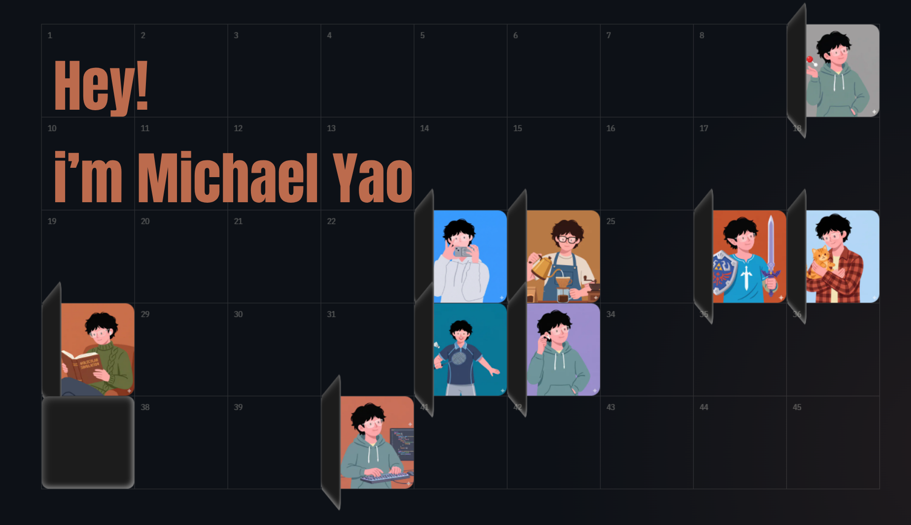
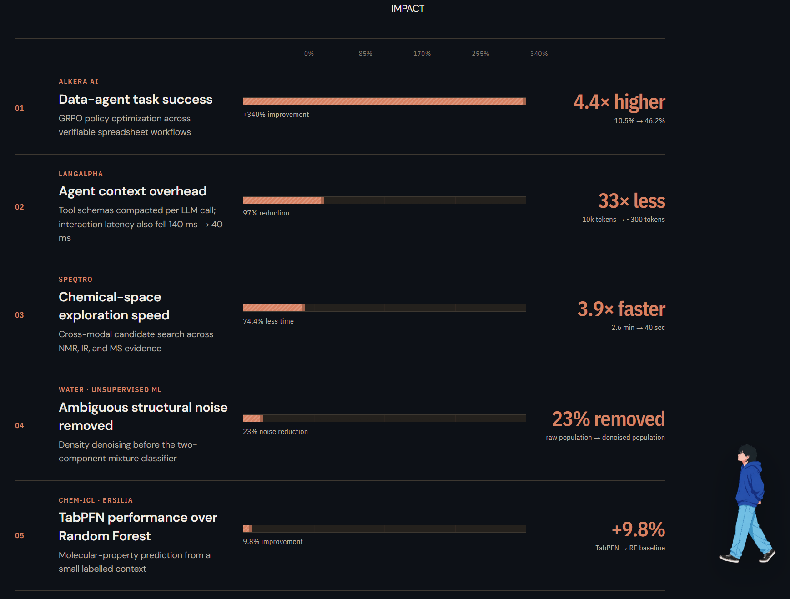
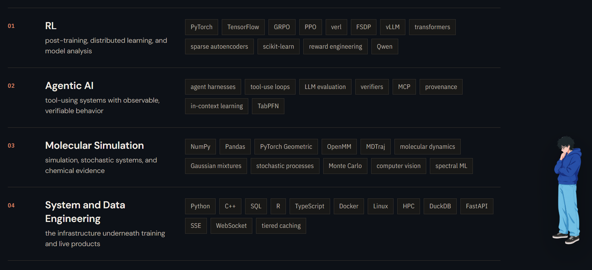

  

  
  
  

  Hi, I'm Michael — a <strong>Computer Science + Mathematics</strong> student at
  <strong>Harvey Mudd College</strong>, Class of 2028. I work across reinforcement
  learning, agentic AI, molecular machine learning, and computational physics.

 

 

